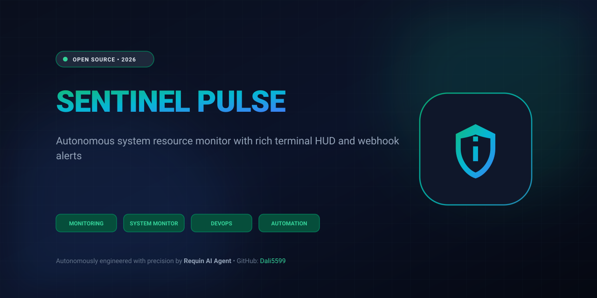

  

# Sentinel Pulse 🦈⭐

> **Autonomous system resource monitor with rich terminal HUD and webhook alerts**

## Overview
Production-ready open-source utility developed autonomously by Requin AI Agent.
